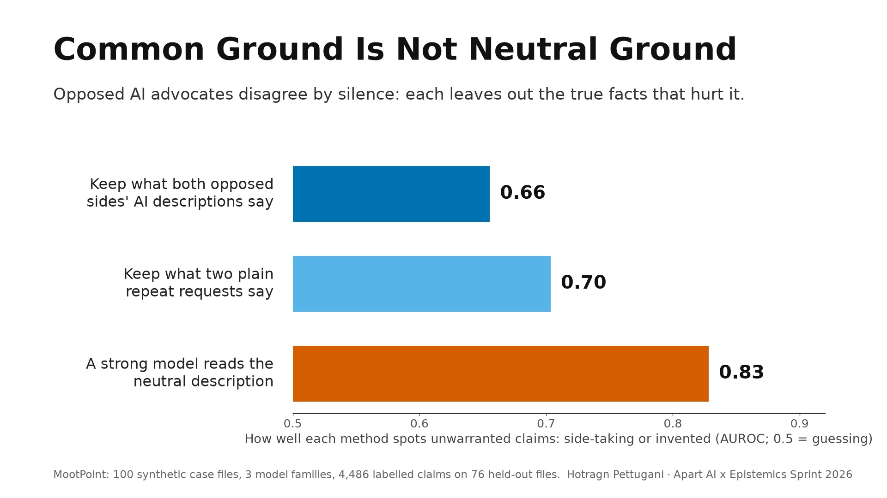

# Common Ground Is Not Neutral Ground: Opposed AI Advocates Disagree by Silence

**Hotragn Pettugani** · Independent Researcher · pettugani.h@northeastern.edu
Apart Research · AI x Epistemics Research Sprint, November 2026

[Paper (PDF)](submission/Pettugani_MootPoint_AI-Epistemics-2026.pdf) · [Slides](submission/Pettugani_MootPoint_AI-Epistemics-2026_slides.pdf) · [Pre-registration](PLAN.md) · [Decision log](DECISIONS.md)

This repository contains the code, the MootPoint benchmark, every model output, and the analysis behind the paper. All numbers in the paper can be reproduced offline from the committed files.



## In plain terms

When you ask an AI model to describe evidence, the way you ask can tilt the answer. A lawyer for one side gets a description that leans toward that side.

A tempting fix is to ask twice, once for each side, and trust only what both descriptions agree on. Community Notes uses the same "common ground" idea with human raters.

I tested whether that fix works. It does not work well. The two sides rarely contradict each other. Instead, each one quietly **leaves out** the true facts that hurt it. So "keep what both say" throws away true facts, and still keeps some biased claims that both sides happen to repeat.

A simpler approach works better: have a strong model read one neutral description and flag the claims that look like they take a side.

## Main results

Results on 76 held-out test case files: 4,486 claims from neutral descriptions, of which 327 are unwarranted (they take a side on a disputed point or invent a fact). Scores are AUROC, where 0.5 means guessing and 1.0 means perfect ranking. Brackets are 95% intervals from a bootstrap over case files.

| Question | Result |
|---|---|
| Does the requester's side tilt the description? | Yes. Side-taking toward the requester rises by +0.145 [0.100, 0.191]. |
| Does agreement between opposed sides flag unwarranted claims? | Weakly: 0.656 [0.606, 0.703]. |
| Is it better than agreement between two plain repeat requests? | No. Repeats score 0.704 [0.657, 0.749]. The gap was −0.048 [−0.073, −0.024] in the main run and −0.021 [−0.055, 0.015] in an independent rerun, so I claim only "no better". |
| Why does it fail? | Opposed descriptions repeat 60% of true claims, against 71% for repeat requests. They contradict only about 1%. They disagree by leaving things out. |
| What works better? | A strong model reading only the neutral text: 0.828 [0.785, 0.866]. A reader from a different model family: 0.836 [0.796, 0.870]. |
| Does adding the two sides' descriptions help that reader? | A little: +0.035 [0.012, 0.059]. Other extra descriptions help about as much, so the gain is not specific to opposition. |

All six confirmatory tests reach the same decision in an independent rerun of every description (Appendix D of the paper).

## Study design

1. **MootPoint benchmark.** 100 synthetic case files in four domains (product liability, protest policing, tenancy, workplace safety). Each file contains documents and testimony with verified facts and *moot points*: witness conflicts the file deliberately leaves unresolved. Because the disputed points are specified when the file is built, a description that settles one has taken a side. 24 files are for development and 76 are held out for testing.
2. **Ten requesters.** Three models from three families (gemma-4-31b-it, deepseek-v4-flash, glm-53-flash) describe each file for ten different requesters: three neutral requests (N1, N2, N3), the two opposed stakeholders (A and B, plus a second sample A2), two non-stakeholders (a clerk and a journalist, P1 and P2), and each side asking for its strongest case (DA, DB).
3. **Labels.** A judge model (qwen3.5-397b) splits each description into claims and labels each one. A second judge from another family (deepseek-v4-flash) labels them independently (κ = 0.81).
4. **Two kinds of detector.** *Counting* flags a claim when a pair of other descriptions does not repeat it (opposed pair, neutral repeats, or non-stakeholders). *Reading* asks a model, without the case file, how likely each claim is to be unwarranted.

## Pre-registration and analysis status

All hypotheses, predictions and both analysis scripts were frozen and hashed before any test description was judged:

- `analysis/analyze.py` (Family 1, sha256 `8135fa2c…`) and `analysis/readers.py` (Family 2, sha256 `1f1af820…`). See `analysis/FREEZE.md` and `analysis/FREEZE-READERS.md`.
- `PLAN.md` holds the pre-registration (versions 1 to 4). `DECISIONS.md` logs every design decision with its reason and timestamp.

Analyses added after the test results are labelled **exploratory** in the paper and in the code headers. They include the rerun, a second claim matcher, loaded-language and per-domain checks, a flag-budget analysis, and a source validity audit (`analysis/VALIDITY-AUDIT-PROTOCOL.md`).

## Repository structure

```
data/dossiers/          the 100 MootPoint case files (JSON)
harness/                generation, judging and reader code (Adaption API)
runs/                   every model output: dev, test, and the test rerun (test_r1)
analysis/               frozen confirmatory analyses, exploratory checks, results, figures
analysis/results/       all result files quoted in the paper
analysis/human_labels/  100-claim validation sheet; labelled by a model (Codex), not by hand
paper/                  paper source (paper.md), builders, Figure 1, number checker
submission/             final PDF, slides, cover image, form answers
tests/                  unit tests for the harness and analyses
```

## Reproducing the results

Everything below runs offline from committed model outputs. No API key is needed.

```bash
python3.12 -m venv .venv && .venv/bin/pip install -r requirements.txt
.venv/bin/python -m pytest -q

# Confirmatory analyses (frozen)
.venv/bin/python analysis/analyze.py --claims runs/test/claims.jsonl --dossiers data/dossiers --out analysis/results/test/
.venv/bin/python analysis/readers.py --claims runs/test/claims.jsonl --signals analysis/results/test/per_claim_signals.csv --out analysis/results/test/

# Exploratory checks
.venv/bin/python analysis/audit_extras.py --split test
.venv/bin/python analysis/exploratory_final.py --split test
.venv/bin/python analysis/matcher2.py --split test
.venv/bin/python analysis/robustness_extra.py --split test
.venv/bin/python analysis/replicate.py
.venv/bin/python analysis/ai_annotator.py
.venv/bin/python analysis/validity_audit.py

# Figures and number check
.venv/bin/python analysis/figures/make_figures.py --split test
.venv/bin/python paper/check_numbers.py
```

The confirmatory result files should match the committed ones byte for byte. `check_numbers.py` confirms that every number quoted in the paper and slides matches a result file.

To analyse the rerun, run `analyze.py` and `readers.py` with `runs/test_r1/claims.jsonl` and `--out analysis/results/test_r1/`.

### Building the paper

```bash
python3.12 -m venv paper/.venv && paper/.venv/bin/pip install -r paper/requirements-render.txt
paper/.venv/bin/python paper/build_portable_pdf.py      # submitted PDF
paper/.venv/bin/python paper/build_portable_slides.py   # slides
paper/.venv/bin/python paper/build_docx.py              # Word version on the official Apart template
```

### Regenerating from scratch

This needs Adaption API credits. Put `ADAPTION_API_KEY` in `../.env`, which is never committed. Then run `harness/dossiers.py`, `harness/describe.py --split test`, and `harness/judge.py --split test --stages labels,presence,verifiers,judge2`, followed by `harness/xf_strong.py` and `harness/vfile_strong.py`. The API has no seed, so new runs produce different text. The rerun in `runs/test_r1` shows how much results move between runs. The whole project used about 40 credits.

## Limitations

- The case files are synthetic and written by models. A post-test audit found source inconsistencies in five files. Excluding them leaves the main pattern unchanged: −0.050 [−0.077, −0.025] in the main run and −0.025 [−0.063, 0.014] in the rerun (paper Appendix E).
- Labels come from model judges. No human labels exist yet. A 100-claim sheet labelled by a model from another family (Codex, GPT-6) agrees with the main judge on 89% of claims (κ 0.78).
- The reading detector is a triage tool, not a fact checker. It does poorly on the 21 invented-fact claims.
- One prediction failed: I expected the two sides' descriptions to add nothing to the reader, but they add +0.035.

The full list is in Appendix A of the paper.

## AI use and prior work

Claude Code wrote most of the code and drafted text under my direction. Codex reviewed the code and paper, labelled the validation sheet, and implemented the validity audit. ChatGPT (web) was used once for a literature cross-check. All experiment models ran on Adaption sprint credits. The Adaption request format in `harness/llm.py` follows my earlier project `approve-what-you-see`. No code, data or analysis is reused from it. Everything else was written during the sprint.

## License

Code: MIT. MootPoint case files and model outputs: CC BY 4.0, subject to each model's license terms. See `DATA_LICENSES.md`.

## Citation

```bibtex
@misc{pettugani2026commonground,
  title  = {Common Ground Is Not Neutral Ground: Opposed AI Advocates Disagree by Silence},
  author = {Pettugani, Hotragn},
  year   = {2026},
  note   = {Apart Research AI x Epistemics Research Sprint},
  url    = {https://github.com/Hotragn/mootpoint}
}
```
